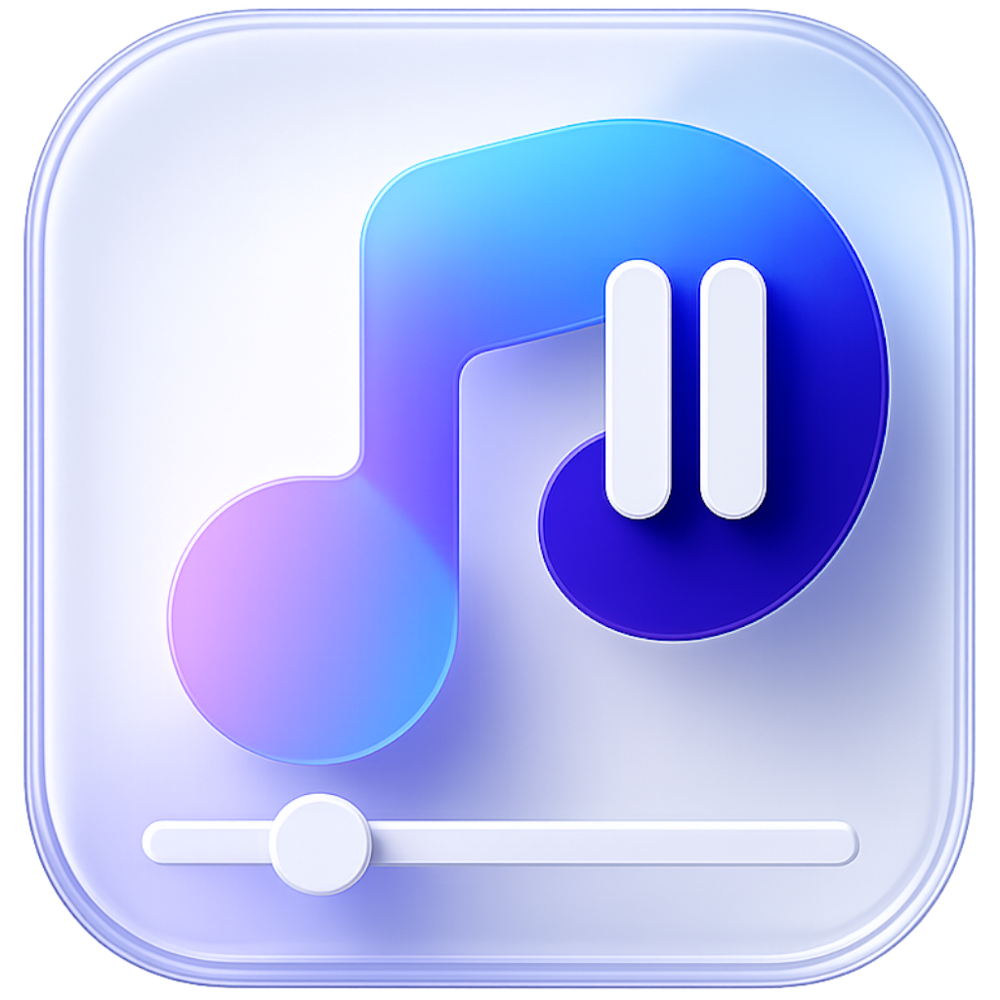

<div align="center">



# Glass Player

### Your local music, in a glass-inspired interface


[Features](#-features) · [Run the app](#-run-the-app) · [Project structure](#-project-structure) · [License](#-license)

</div>

**Glass Player** is a Flutter music player for a personal audio library. Import your tracks, organize playlists and a play queue, and listen through a responsive interface with glass-style themes and animated backgrounds. Music and library data stay on your device or in your browser's local storage; no account is required.

## ✨ Features

| Area | What is included |
| --- | --- |
| 🎵 Playback | Play, pause, seek, next and previous; ordered playback, repeat all, repeat one, and shuffle. |
| 📂 Library | Import audio files, search and sort tracks, view track details, and remove selected items. Supported file extensions: MP3, M4A, AAC, WAV, FLAC, and OGG; actual playback support depends on the target platform. |
| 🗂️ Organization | Create and rename playlists, add tracks, manage the play queue, and keep your library between sessions. |
| 🏷️ Metadata | Read title, artist, album, duration, and cover art when available. View or edit lyrics and adjust lyric animation and timing. |
| 🎨 Personalization | Switch themes and backgrounds; adjust overall UI and text size. |
| 🔔 Media controls | `audio_service` supplies media-session and notification controls where the platform supports them. |

The source includes Flutter targets for **Android, iOS, web, Windows, macOS, and Linux**. Each target needs its own Flutter toolchain and device permissions; platform behavior should be checked on the devices you plan to support.

<details>
<summary><strong>📀 Where does the library live?</strong></summary>

The current library uses Drift/SQLite for tracks, playlists, and queue data. Hive stores preferences and supports migration of an older Hive library. On web, selected files and database data use browser storage; clearing site data can remove the imported library.

</details>

## ▶️ Run the app

Install a Flutter SDK with a compatible Dart SDK (`^3.9.2` in [`pubspec.yaml`](pubspec.yaml)), then run from the repository root:

```bash
flutter pub get
flutter devices
flutter run -d windows
```

Replace `windows` with a device ID from `flutter devices`, for example `chrome` for web or an attached Android device. The local `plugins/flutter_media_metadata` package is part of this repository and is used by the app through `dependency_overrides`.

On supported native devices, the app can scan common music locations and also offers manual file import. In the web version, choose audio files to import into the browser library. Grant media access when your operating system requests it.

### Web deployment note

The web build includes `sqlite3.wasm` and `drift_worker.js` for local database storage. Serve the build over HTTP(S) with the correct WASM MIME type; [`web/.htaccess`](web/.htaccess) provides an Apache example. [`web/index.html`](web/index.html) currently loads **MediaInfo.js from unpkg.com**, so web metadata reading may need a network connection and a content-security policy that permits that CDN. This is the one external web asset to account for when deploying the app as a fully offline site.

Use the standard JavaScript web build (`flutter build web`). The bundled metadata plugin uses legacy `package:js` interop and is not compatible with Flutter's experimental WebAssembly build.

## 🧩 Project structure

| Path | Purpose |
| --- | --- |
| `lib/main.dart` | App startup, Drift library database, storage migration, and audio-service setup. |
| `lib/style.dart` | Playback and library actions, playlists, queue, lyrics, themes, and interface widgets. |
| `plugins/flutter_media_metadata/` | Bundled, locally overridden metadata plugin. |
| `assets/` | App icon and fallback cover art. |
| `web/` | Web entry point, SQLite WASM and worker, web icons, and hosting configuration. |
| `android/`, `ios/`, `linux/`, `macos/`, `windows/` | Flutter platform projects. |

For development, run `flutter analyze` before building and check import, playback, queue, and persistence on each target you intend to release.

## ⚖️ License

The project source is available under the [MIT License](LICENSE). Bundled third-party components, including `plugins/flutter_media_metadata`, retain their own license terms.
